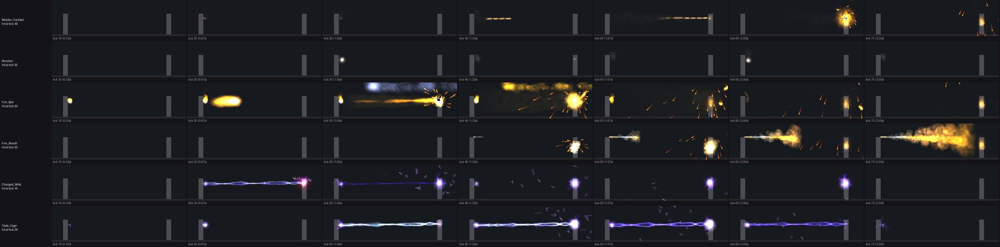

# Enemy setup: Atlas Park's villain groups

This is step 6 of the game systems build order (2026-10-20). It brings in Atlas Park's original enemies: which groups spawn where and in what makeup, their models, their original powers with the moves and effects those powers play, and their idle behaviors. It builds on the AI plan (`coh-enemy-ai-plan`, `tools/ai/coh_ai.py`) and the Unreal combat code that already exists (`ACoHCombatEnemy`, `ACoHEnemySpawner`).

The rules come from the original source (Thunderspies/CityOfHeroes):

- `MapServer/src/generator/encounter.c`: spawn definitions and team sizes.
- `Common/gameComm/VillainDef.c` (`villainFindByCriteria`): which villain fills a "Hellions Minion at level 3" slot.
- `Common/seq/seqtype.c`: an entity type with no `SequencerType` uses the sequencer's file name.
- `Common/entity/powers_load.c` (`power_FixupForBinFX`): timing defaults. `FramesBeforeHit` is 15 when not set, and a `DelayedHit` power with no `ProjectileSpeed` flies at 60 ft/s.

## Tools

```
python tools/ai/coh_encounters.py <i24>/data export out/enemies     # encounters.json, roster.json
python tools/ai/coh_encounters.py <i24>/data summary
python tools/ai/coh_encounters.py <i24>/data roll Hellions Minion 3
python -m coh2unreal.enemies --data <i24>/data --piggs <piggs> --out out/enemies [--group Hellions] [--all-costumes]
python -m coh2unreal.fx --data <i24>/data --piggs <piggs> --out out/enemies/fx export \
    --powers-json out/enemies/enemy_power_anims.json --all
python -m coh2unreal.fxsim --lib out/enemies/fx --power Hellions.Molotov.Molotov_Cocktail --out sheet.png
```

`coh_encounters.py` needs the sparse paths `data/maps/city_zones/city_01_01` and `data/scripts.loc/spawndefs/city_01_01` in the i24 checkout. The outputs are game data and stay out of git.

| Output | What it holds |
| --- | --- |
| `encounters.json` | Each spawn definition the zone's spawn layers use: level band, team size range, respawn, kind (patrol, spraypaint, ledgesit ...), how many spots use it, and its actors (group and rank or named villain, count, the team sizes it appears for, `AI_InActive` / `AI_Active` behaviors, dialog). `rolls` lists, per level, the villains the slot can roll. |
| `roster.json` | Each villain def that can spawn: group, rank, class, AI config, level range, costumes, powers, weight (how many spots can roll it) |
| `kit.json` | Per villain: the above plus entity type, sequencer and sequencer type, each power with its timing, effects and resolved move segments, idle anim lists with their moves, the clip list, and the model file |
| `enemy_power_anims.json` | The villains' powers in `power_anims.json` form |
| `models/<costume>.gltf` | Rigged models (36 costumes). Each clip is named after its sequencer move, plus `idle`, `run`, `attack`, `hit`, `death`. |
| `fx/` | Same layout as the player effects (`fx_library.json`, `power_fx.json`, `textures/`, `sounds/`, `geoms/`) |

## Results

- **347 spawn definitions** in Atlas Park's layers. Encounter spots by group: Hellions 399, Paragon Police 92, Clockwork 78, Skulls 48, Freedom Corps 40, Vahzilok 32, Arachnos 17, objects 14, Infected 4, Praetorian angry citizens 2. Levels are mostly 1 to 6.
- **69 villain defs** can spawn. All 69 export with their models, powers and moves, and nothing is left unresolved.
  - Hellions: five thugs (axe, bat, brawl, knife, sledgehammer), shotgun and SMG lieutenants, the boss and the informant.
  - Clockwork: Sprocket, Oscillator, Tesla and Cannon lieutenants, Assembler, Tesla and Cannon bosses. They play their own robot sequencer.
  - Also Skulls, Vahzilok, Infected, Arachnos (Wolf Spiders), Paragon Police, Freedom Corps and protesters.
- **111 enemy powers**, which use 150 effects, 327 particle systems, 101 textures and 123 sounds (33 MB). The only missing file is `physics_sparks.fx`, which the game data lacks too.
- **Moves.** Each power picks its move on the villain's own sequencer, as the game does. Hellions play the male player moves: Brawl is `Brawl_R`, the Revolver draws and hip-fires, the Molotov is a lob. Thugs carry 18 idle anim lists (menace, arms crossed, spray paint, chat ...) for their encounter behaviors.
- **Fix found on the way.** Some moves start past the end of their animation (CrateReady starts at frame 45 of 44). The exporter now holds the last frame, as the game clamps it.



The preview shows the Molotov arcing and bursting into flame, the revolver's muzzle flash, the Hellion boss's fireball and breath, and the Clockwork's electric bolts and cage. The preview has no animation, so Fire Breath's stream starts a few ticks after its hit burst; in game the stream is timed by the breath move.

## Unreal side (PC session)

The spawner and combat enemy exist. This step swaps their guesses for the original data.

1. **Import.**
   - Bring `models/*.gltf` in as Skeletal Meshes with their animations. They use the same skeletons as the player models from step 2 (male, female, huge), except Clockwork, zombies and other monsters, which have their own.
   - Import `fx/` as in `docs/power-effects.md`.
   - Copy `kit.json` and `encounters.json` to `Content/CoH/Data/`.
2. **Villain catalog.** Load `kit.json` into the catalog that `ApplyVillain` uses: the model, the powers with their timings, and the clip for each move. Each attack plays its own moves (`moves.<seq_type>.segments`) and effects through the step 5 effect player (`UCoHEffect`), in place of the single `attack` clip. Damage lands at the hit time, as for the player.
3. **Original encounters mode in `ACoHEnemySpawner`.** It fills groups the way the original zone did:
   - Pick a spawn definition by its spot weight. Pick a team size between `min_team` and `max_team`, scaled by the number of heroes nearby.
   - Each actor appears when the team size is between its `min_heroes` and `max_heroes`.
   - Roll each slot's villain from `rolls[level]`, at a level inside the definition's band.
   - Idle with the actor's `ai_inactive` behavior: play its anim list moves (`anim_lists`), loiter or patrol. Switch to `ai_active` or the villain's AI config when alerted.
   - Respawn after `respawn` seconds.
   - The new map's layout differs from the original, so encounter spots are placed on the new map by kind (street corners for spray paint, ledges for ledgesit, park paths for patrols) and kept out of the City Hall plaza.
4. **Server settings.** Original encounters are the faithful mode and are on by default. The wandering gangs (`bWanderingGangs`) stay an addition that can be turned off, and they now use the same group makeups and villain rolls.
5. **Check.** Spawn a Hellions spray-paint group at level 2 with `SpawnTestGroup` and confirm: they idle with spray-paint and arms-crossed moves, then fight with Brawl, the revolver and the Molotov, with the effects in the preview.

## Next

With powers, leveling and enemies in place, Atlas Park has a full game loop to playtest. Open items for later: pets (Rain of Fire's pseudo-pet), sequencer-triggered effect conditions, and dialog lines from the spawn definitions.
