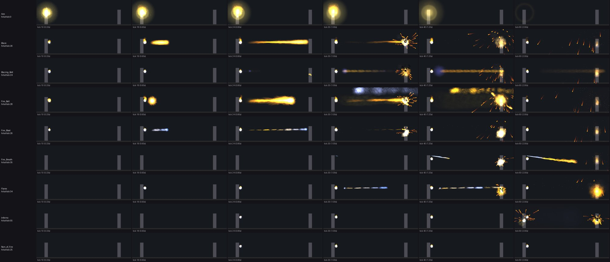
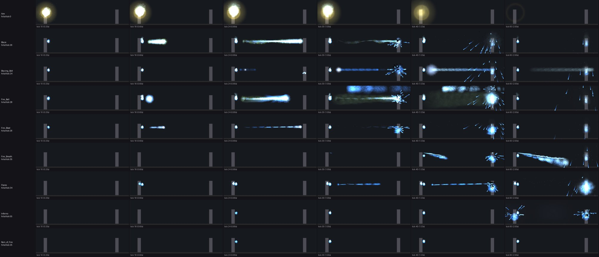

# Power effects: original .fx to Niagara

This is step 5 of the game systems build order (2026-10-20). Every player power names its effects in the powers data (`ActivationFX`, `AttackFX`, `HitFX`, `ContinuingFX` ...). The converter reads those effects as the game does and writes them out with the original parameters, so Unreal can play them on the player models from step 2. Fire Blast is the first set checked end to end.

The rules come from the original client source (Thunderspies/CityOfHeroes):

- `Game/src/graphics/FX/particle.c`: particle systems.
- `fx.c` and `fxgeo.c`: effect timelines and moving nodes.
- `Common/fxinfo.c` and `fxbhvr.c`: the file formats.

## Tools

```
python -m coh2unreal.fx --data <i24>/data --piggs <piggs> --out out/fx export \
    --powers-json out/powers/power_anims.json --set Blaster_Ranged.Fire_Blast   # or --all, --power, --fx
python -m coh2unreal.fxsim --lib out/fx --set Blaster_Ranged.Fire_Blast --out sheet.png \
    [--theme "Bright Fire" --colors 40,120,255,180,240,255] [--ticks 10,18,24,30,40,60]
```

| Output | What it holds |
| --- | --- |
| `fx_library.json` | `fx` (timelines), `parts` (particle systems), `behaviors`, `geoms` (pivot and mesh models with their alternate pivots and trick), `materials` (layered `X_` textures), `textures`, `sounds`, `missing` |
| `power_fx.json` | Per power: the effect paths, `FramesBeforeHit`, `ProjectileSpeed`, `DelayedHit`, and the same for each customizable theme |
| `textures/*.png` | Particle and effect mesh textures |
| `sounds/*.wav` | Effect sounds, converted from the game's .ogg with ffmpeg |
| `geoms/*.gltf` | Visible effect meshes, such as Blazing Bolt's flame beam. Converted like the characters: meters, z negated. |

Units in the JSON are the game's:

- Distances are in feet (1 ft = 30.48 cm).
- Time is in ticks of 1/30 s, so velocities are feet per tick.
- Angles and spin are in 1/256 turns.
- Colors are 0 to 255.
- Paths are lower case and relative to `data/fx`.
- Every particle field is present, with the engine's defaults filled in. For example, `Alpha` 0 means 255, and two-value fields are `[full power, low power]`.

## Results

- **Fire Blast:** 9 powers, 83 effects (default and themed), 183 particle systems, 24 behaviors, 43 textures, 16 sounds. One file the powers name, `powers/firecontrol/physics_sparks.fx`, isn't in the game data.
- **All player powers (`--all`):** all 3,105 powers convert. See the counts and the `missing` list in `fx_library.json`. The gaps are:
  - A few dozen effect, part and behavior files the data names but doesn't ship.
  - About 130 layered textures (`X_...`, defined in `data/tricks`) used by effect meshes outside Fire Blast. These resolve through `materials` where they are defined.





The previews are made by `fxsim`, a port of the game's particle update:

- Spawn rate, burst, jitter, velocity, gravity, drag, magnetism, size expansion, fades, the color path, streaks and blend modes all follow the original.
- The effect timeline plays as in the game:
  - Time conditions, `PrimeHit` when the projectile reaches the target, `Destroy`, `LifeSpan`, child effects.
  - Projectiles track the target at the behavior's `TrackRate`. That is 3 ft per tick, the 90 ft/s `ProjectileSpeed` of Fire Blast.
  - Alternate pivots aim events. Fire Breath's stream leaves the mouth through pivot 4 of `LocalPivot01`.
- The hit effect starts when the hit lands: `FramesBeforeHit`, plus the travel time for `DelayedHit` powers.

What the previews show:

- The bolts fly, the hit bursts with sparks and smoke, and the cinders linger.
- Themed effects take the player's two power colors through `PrimaryTint` and `SecondaryTint`, as customizable powers did. The second image shows this.

The preview skips some things:

- The body is a static stand-in, with no animation.
- Physics debris, sequencer-triggered conditions (`TriggerBits`, `Cycle`) and mesh geometry are not drawn.
- Rain of Fire's rain comes from a summoned pseudo-pet, so it needs the pet step and shows only the hand flames here.

## Unreal side (PC session)

1. **Import.**
   - Bring `textures/` in as Textures. Bring `sounds/` in as Sound Waves.
   - Bring `geoms/*.gltf` in as Static Meshes. They are additive, unlit and two-sided, with UV scroll from the geom's `trick` (`ScrollST0`).
2. **Material per texture and blend.** Make one Material Instance per (`TextureName`, `Blend_mode`) pair, from the master particle materials. The blend modes map as follows:
   - `Additive` uses the additive blend.
   - `Normal` uses translucent.
   - `Subtractive` uses a translucent material that subtracts.
   - `Multiply` uses modulate.
   - `PremultipliedAlpha` uses translucent with a premultiplied output.

   Flipbooks use `AnimFrames1`. The grid is 2x1 for 2 frames, 2x2 for 4, 4x2 for 8, 4x4 for 16 and 8x4 for 32. `TexScroll1` scrolls the texture.
3. **One parametric Niagara system, `NS_CoHParticle`.** A C++ helper fills its user parameters from a part entry:

   | Part field | Niagara |
   | --- | --- |
   | `NewPerFrame` x 30 | Spawn rate per second |
   | `Burst` | Spawn burst at 0 |
   | `MoveScale` | Spawn per unit moved |
   | `BurbleAmplitude` | Extra spawn rate, driven by noise |
   | `EmissionLifeSpan` | Stop spawning after that many ticks |
   | `FadeOutBy` / 30 | Particle lifetime (s) |
   | `FadeInBy`, `FadeOutStart` | Alpha ramp in, hold, ramp out, x `Alpha`/255 |
   | `ColorNav` (up to 5 points, ticks) | Color, piecewise linear by age in ticks. `ColorChangeType` 1 loops. A scratch module evaluates the 5 points. |
   | `PrimaryTint`, `SecondaryTint` per point | Mix with User.PrimaryColor and User.SecondaryColor (the player's power colors) |
   | `EmissionType` 0-5 | Point, line to `POther`, cylinder (`EmissionRadius`, `EmissionHeight`), trail between frames, sphere, even line |
   | `EmissionStartJitter` | Box location offset, ± ft |
   | `InitialVelocity` ± `InitialVelocityJitter` | Velocity, in the attach node's frame. ft/tick x 914.4 = cm/s. |
   | `VelocityJitter` | Random velocity added each tick |
   | `Gravity` | Acceleration down, ft/tick² x 27,432 = cm/s² |
   | `Drag` | Linear drag per tick |
   | `Magnetism` | A constant pull on each axis toward `PMagnet` |
   | `Stickiness` | Particles follow the emitter's movement by this fraction |
   | `StartSize` ± `StartSizeJitter`, `ExpandRate`, `ExpandType`, `EndSize` | Sprite size = 2 x size x 30.48 cm. The size grows forever, stops at `EndSize`, or ping-pongs. |
   | `OrientationJitter`, `Spin` / `SpinJitter` | Sprite rotation (1/256 turns), spin 0.1 x value per tick |
   | `StreakType` 1-8, `StreakScale`, `StreakDirection`, `StreakOrient` | Velocity-aligned sprites stretched to the streak point (velocity x scale, emitter, magnet, other). Chain and the `Ribbon` flag use a ribbon renderer. |
   | `WorldOrLocalPosition` 1 | Local-space emitter |
   | `TightenUp` | Camera offset (sort bias) |
   | `Flags` `FadeImmediatelyOnDeath` | Kill the particles on deactivate, not let them fade |

   An alternative is one baked Niagara asset per `.part`, made by an editor script. With 11,803 parts across all powers, the parametric system is the practical route.
4. **Effect player (C++ component, `UCoHEffect`).** It plays an `fx` entry on a character, with a target:
   - **Conditions.** `Time` fires at the tick. `PrimeHit` / `PrimeNHit` fires when that node reaches its magnet. `Cycle` repeats while the effect loops. `TriggerBits` fires on sequencer states. `Death` fires when the effect ends. `Chance` and `Repeat` also apply.
   - **Events.**
     - `Create` and `Local` attach a node to a bone socket (`At WepR`, `Chest`; `T_` means the target).
     - `Start` places the node at the bone, then moves it by its behavior. It tracks `Magnet Target` at `TrackRate` ft/tick, or moves by velocity and gravity.
     - `Posit` and `PositOnly` place the node by position only.
     - `Destroy` deactivates a named node, or `all`.
     - `LifeSpan` deactivates the node after that many ticks.
     - `ChildFx` plays a nested effect on the node.
     - `Sound` plays the sound with its radius and volume.
     - `Geom` gives the node a pivot model or a visible mesh.
     - `AltPiv N` puts the node on the parent model's alternate pivot N. `alt_pivots` holds the game's 4x3 matrices: axes, then position, in feet.
   - **Power hookup.**
     - The power component from step 3 plays `ActivationFX` and `AttackFX` with the attack animation from step 1.
     - It plays `HitFX` on the target at `FramesBeforeHit`, plus the travel time at `ProjectileSpeed` ft/s for `DelayedHit` powers. Damage applies at the same moment.
     - `ContinuingFX` plays while a damage-over-time or status lasts.
     - The player's theme choice picks the `themes` entry and sets the two colors.
5. **Check against the previews.** Play Fire Blast on Positron against a target 30 ft away and compare with the two images above.

## Next

Step 6 is enemy setup. It covers the Atlas Park villain groups with their original powers, AI scripts (see `coh-enemy-ai-plan`), animations and these same effects.
